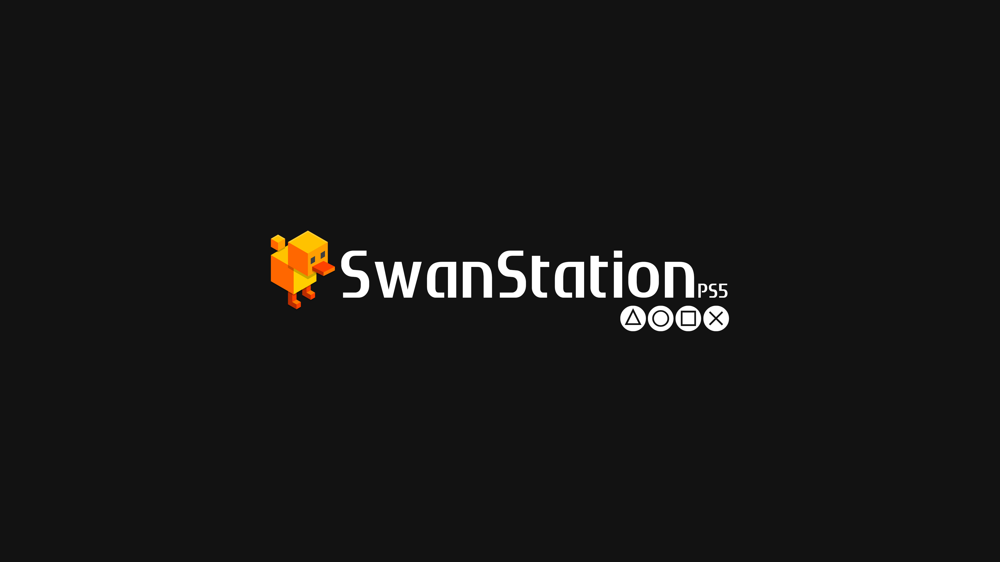

<p align="center">
  
</p>

<p align="center">
  
  
  
  
  
</p>

---

## What is SwanStationUWP?

SwanStationUWP is a PlayStation 1 emulator for the **Xbox Series X|S** in developer mode. It is a UWP app that runs
on the console next to your other apps, with a cover-flow shelf for your games, and runs them on
[SwanStation](https://github.com/libretro/swanstation) (DuckStation's libretro core).

> **Looking for the PS5 version?** This repository is the Xbox Series X|S version only. The PS5 version, with its
> own releases, is here: **<https://github.com/darkxex/SwanStationPS5/releases>**

It began as a port of SwanStationPS5 (itself a fork of [PSXS5](https://github.com/SynoPiia/PSXS5) by SynoPiia). The
PS5 app was replaced, not kept alongside: what is here is the Xbox app.

**Status.** The interface and the games run on a Windows PC with the same package. Running on a console is the aim
and is still being tested, so expect rough edges there. Open an issue if you find one.

## What it does

- **SwanStation, drawn on the GPU through Direct3D 11.** The picture of the game, the shelf and the menus share one
  device. Internal resolution from native to 16x, PGXP (precise geometry), MSAA, texture filtering (including MMPX)
  and the widescreen hack, among the 100+ options of the core. A software renderer is there as a fallback.
- **A shelf for your games.** Cover flow with 3D jewel cases and a reflection under each cover, five themes, favorites,
  recently played, sort orders, and Details with the title and gameplay pictures. Covers are matched by the serial
  read from each disc and download by themselves; your own image wins.
- **Plays every common format.** `.cue`/`.bin`, `.chd`, `.pbp` (including multi-disc), `.iso`, `.img`, `.mdf`,
  `.ccd`, and `.m3u` playlists for multi-disc games. A `.ppf` patch next to a game is applied when it starts.
- **Shaders for the picture.** LCD3x and zfast LCD, four analog NTSC ones, and CRT looks (CRT Royale and Royale Fast,
  Newpixie, Hyllian NTSC, Mattias, Lottes, Pi), plus scanlines, integer scaling, aspect ratios and cropping.
- **Sharp output.** The swap chain follows the TV's mode (1080p or 4K, and its refresh rate when it has one).
- **RetroAchievements.** Unlock pop-ups, an achievements list with progress, your profile, leaderboards and an
  optional hardcore mode.
- **Cheats for every game, automatically.** libretro-database's PlayStation cheats and DuckStation's chtdb: when a
  game starts its file is found and downloaded; you switch codes on and off from the game menu.
- **Save states and quick resume.** Ten slots per game with a thumbnail, auto-saves, rewind and fast forward, and a
  memory card per game with a manager that shows each save's icon and imports `.mcr`, `.mcd`, `.srm` and `.gme`.
- **Profiles.** Each person keeps their own memory cards, states, settings, play time and RetroAchievements sign-in.
- **Up to 4 players** with the multitap, on XInput controllers, with rumble.
- **Text guides and manuals** readable from the game menu.
- **Five languages:** English, Français, Português (Portugal), Español (Latinoamérica) and 日本語.
- **Settings from your phone.** Turn it on and scan the QR code: a page opens on any phone on the same network.
- **A log that helps.** A session log stays in the app's folder (see [Troubleshooting](#troubleshooting)).

## What you need

- An **Xbox Series X|S in developer mode** (Dev Home), with *Remote Management* on. Developer mode needs the one-time
  activation of the Xbox developer account.
- A **Windows PC** with Visual Studio 2022 to build the package, and the Windows SDK. (There are no prebuilt
  releases of the Xbox app yet.)
- **Your own games**, dumped from discs you own.
- **Optional, but recommended: your own PS1 BIOS**, dumped from your own console. Without one SwanStation uses its
  built-in OpenBIOS, which is less compatible.

> **No BIOS files, games, keys or cheats with copyrighted content are included with SwanStationUWP, and none will be
> provided.** You have to supply your own legally made backups.

## Getting started

1. **Build the package** on the PC (see [Building from source](#building-from-source)). It ends in
   `dist\SwanStationXbox_<version>_x64_Test\`.
2. **Install it on the console.** On the Xbox: Dev Home → *Remote Management* on; note the IP. On the PC:
   ```powershell
   .\tools\deploy-xbox.ps1 -Ip <console IP> [-Pin <pin>]
   ```
   If the install says the signature is untrusted, upload `xbox\SwanStationXbox.cer` in the Device Portal first
   (*Add*). Visual Studio can also deploy to the console (project properties → Debugging → Remote Machine).
3. **Open SwanStationUWP** from *My games & apps* → *Dev Home*. It creates its folders and shows a shelf that tells
   you where games go.
4. **Add your games**, one folder per game with every file of the game inside (see [Games and BIOS](#games-and-bios)).
5. **Optional: add your BIOS.** *Settings → About* shows which one is in use.
6. **Restart the app** so it scans the library again. Covers download the first time.

To try the package on the PC before the console, run `.\tools\install-pc.ps1` from PowerShell as administrator (it
trusts the certificate and installs; Windows needs Developer Mode on).

## Games and BIOS

### Games: one folder per game

The games are looked for in all of these places at once. Inside each, **one folder per game**, with every file of the
game in it (`.cue` + `.bin`, `.chd`, `.pbp`, `.iso`, `.m3u`...):

| Where | Folder |
|---|---|
| **The app's own folder** | `LocalState\SwanStation\games\<Game name>\` |
| **Any drive** (a USB drive, the extended storage) | `<letter>:\psx\<Game name>\` |
| | `<letter>:\SwanStation\games\<Game name>\` |
| | `<letter>:\SwanStation\<Game name>\` |

The console gives a USB drive or the extended storage whatever letter it likes, so every drive is looked at. The
folder name `psx` can be changed in *Settings → System → Games folder on drives*.

Example: `E:\psx\Crash Bandicoot\Crash Bandicoot.chd`.

> **A drive shows nothing?** A UWP app can only read a drive where Windows allowed it. Open *Settings → System →
> File access*: it opens Windows' *File system* privacy page and says whether the access is *Blocked* or *Allowed*.
> The empty shelf says it too when every drive but `C:` refuses.

### BIOS

Put the BIOS files directly in a `bios` folder, not in a subfolder, and keep their standard names: `SCPH1001.BIN`
(recommended), `scph5500.bin` (Japan), `scph5501.bin` (USA), `scph5502.bin` (Europe), `scph101.bin`.

| Priority | Folder |
|---|---|
| 1st | `LocalState\SwanStation\bios\` |
| 2nd (only if the first has no `.bin`) | `<letter>:\bios\` or `<letter>:\SwanStation\bios\` on the first drive that has one |

With *Auto*, the BIOS of the game's region is used; if there is none for the region but there is another, that one
is given to the core. With no BIOS at all, SwanStation uses its built-in OpenBIOS.

### The app's folder

```text
%LOCALAPPDATA%\Packages\SwanStationXbox_*\LocalState\SwanStation\
├── games\<Game name>\         your games, one folder per game (a cheats.cht here overrides the library)
├── bios\                      optional: your BIOS dump (scph*.bin)
├── covers\                    your own cover images; downloads in default\ and 3d\, picks in custom\
├── cheats\                    the cheat library
├── saves\                     memory cards, one per game
├── states\                    save states, 10 slots per game
├── screenshots\
├── import\                    memory cards to import
├── logs\SwanStationPS5.log    the session log (send this with bug reports)
├── retroachievements.ini      RetroAchievements sign-in (token only)
└── SwanStationPS5.ini         settings
```

On the console the Device Portal's *File explorer* shows the same folder under the app's `LocalState`.

## Covers for games without one

Covers are downloaded by the game's serial. A game that is not found (a homebrew, a translation, a hack) shows a
plain title card until you give it a cover. Name the image like the game's disc file, without the extension
(`yume_nikki.cue` → `yume_nikki.png`) and put it:

| Where | File name |
|---|---|
| The game's own folder, next to the `.cue` | `yume_nikki.png`, or just `cover.png` |
| `LocalState\SwanStation\covers\` | `yume_nikki.png`, the game's title (`Yume Nikki.png`) or its serial (`SLPS-01234.png`) |

Or pick one by hand: on the shelf press **Y** (Details), then **X**, and choose an image from `covers\` or the game's
folder. Formats: `.png`, `.jpg` and `.jpeg`, with the extension in lowercase.

## Controls

An Xbox controller (or any XInput pad). **View** takes the place of the PS1 controller's touchpad-style shortcuts:
tap it for Select, hold it for the shortcuts.

**On the shelf**

| Button | Does |
|---|---|
| D-pad or left stick | Browse the games |
| LB / RB | Category (All games, Recently played, Favorites...) |
| A | Play |
| Y | Game details (hold Y there to delete the game's files) |
| X | Settings |
| R3 | Favorite |
| View | Memory cards |
| Menu | Sort order |
| B | Back (hold B for 2 seconds to close the app) |

**In a game**

| Button | Does |
|---|---|
| Menu | PS1 START |
| View tap | PS1 SELECT |
| Hold View + R3 | The game menu (*Settings → Controls → View button shortcuts* can change it to L3 + R3, or Menu + View) |
| Hold View + RT | Fast forward |
| Hold View + LT | Rewind (turn on *Settings → System → Rewind*) |
| Hold View + X | Screenshot |
| Hold View + Y / B | Start or pause / reset the speedrun timer |
| Left stick | Analog stick; on digital-only games it also drives the D-pad |

The **game menu** has: resume, save and load state (slots 0–9) and the auto-saves, disc change for multi-disc games,
cheats (and *Find a code* to make your own), achievements, the manual and text guides, settings, reset and quit to
the shelf. It also shows the time and how long you have been playing.

**Text guides:** put a walkthrough or FAQ (`.txt`) in the game's folder, or in a `guides` folder inside it. **Manuals:**
page images (`1.jpg`, `2.jpg`...) in `<game folder>\manual\`.

## RetroAchievements

SwanStationUWP asks for your password only to swap it for a login token; only the token is kept
(`retroachievements.ini`). Sign in from *Settings → Achievements*. With several profiles, each person signs in for
their own.

- Hardcore mode follows RetroAchievements' [hardcore compliance requirements](https://docs.retroachievements.org/general/hardcore-compliance-requirements.html):
  cheats, save states, quick resume, rewind and autosave are off, and turning it on resets the running game.
- Without a connection, unlocks are kept and sent when the console is back online.
- Games are recognised by the same disc hash RetroArch uses, so the usual Redump dumps work.

## Troubleshooting

- **The log:** `LocalState\SwanStation\logs\SwanStationPS5.log` (the previous run is `SwanStationPS5.old.log`). It is
  written before anything else starts. Attach it to bug reports.
- **On a console,** the Device Portal (`https://<console IP>:11443`) shows the app's files and its crash dumps.
- **The shelf is empty,** or a drive's games do not show: see *File access* above.
- **The picture is slow with the CPU renderer:** use *Settings → Graphics → Renderer → GPU*. The CPU one is a fallback.
- **A new version asks about factory settings** once, the first time it starts.

## Building from source

On Windows 10/11 with **Visual Studio 2022** and these components: *Desktop development with C++* is not enough;
install *Universal Windows Platform development* with the C++ UWP tools, and the
`Microsoft.VisualStudio.Component.Windows10SDK.19041` component. Git and PowerShell 5.1 or later.

```powershell
git clone --recurse-submodules https://github.com/darkxex/SwanStationUWP.git
cd SwanStationUWP
.\tools\build-xbox.ps1            # icons, Mesa, the core, NuGet and MSBuild
.\tools\build-xbox.ps1 -SkipCore  # the same, without rebuilding the SwanStation core
```

The package ends in `dist\SwanStationXbox_<version>_x64_Test\` (`.msix` and the `.cer` that signed it). The signing
certificate is self-signed and made by the script.

| Path | What |
|---|---|
| `src/main.c` | screens and main loop |
| `src/core/host.c` | libretro host for SwanStation |
| `src/core/swanstation_options.c` | the core's options, made by `tools/gen_swanstation_options.py` |
| `src/ra/` | RetroAchievements |
| `src/ui/` | cover flow, text, sounds, settings |
| `src/platform/uwp/` | the UWP layer: Direct3D 11 output and shaders, XAudio2, XInput, files, network |
| `xbox/` | the Visual Studio project, the manifest and the package assets |
| `third_party/swanstation` | the core (a submodule). Our changes to it are `tools/patches/SSPS5.patch` and `SSXBOX.patch`, which `tools/build-core.ps1` applies in that order |
| `tools/build-xbox.ps1`, `install-pc.ps1`, `deploy-xbox.ps1` | build, install on the PC, install on the console |
| `tools/fetch-mesa.ps1` | fetches the Mesa DLLs with pinned hashes and restores any that differ |

The version lives in two places that must match: `SwanStationPS5_VERSION` in `src/SwanStationPS5.h` and `Version` in
`xbox/Package.appxmanifest`.

## Credits

SwanStationUWP comes from SwanStationPS5, which started as a fork of [PSXS5](https://github.com/SynoPiia/PSXS5) by
SynoPiia, and is built on the work of a lot of people. Thank you all.

* **The SwanStation and DuckStation contributors**, for [SwanStation](https://github.com/libretro/swanstation), the emulator.
* **The Mesa project**, for [Mesa](https://www.mesa3d.org/) and its Dozen driver, and **Misunderstood-Wookiee** for
  [RetroArch-UWP](https://github.com/Misunderstood-Wookiee/RetroArch-UWP), the reference for how a UWP emulator
  runs on an Xbox.
* **[RetroAchievements](https://retroachievements.org)**, for the achievements, the community that makes the sets,
  and its [rcheevos](https://github.com/RetroAchievements/rcheevos) library.
* **[xlenore/psx-covers](https://github.com/xlenore/psx-covers)**, for the covers the shelf downloads.
* **sodaraptor** ([@sodaraptor_dev](https://sodaraptor.itch.io/psx-jewel-case)), for the PSX jewel case model and
  textures the shelf's 3D cases are built from: [Hypnagogia 無限の夢 Boundless Dreams Jewel Case](https://sketchfab.com/3d-models/hypnagogia-boundless-dreams-jewel-case-20e4780167b6441fb364060c79870378) (CC-BY 4.0).
* **The [libretro-database](https://github.com/libretro/libretro-database) contributors**, for the PlayStation cheat library.
* **crashGG**, for MMPX 3.0 and 3.2, and **Morgan McGuire and Mara Gagiu**, for [MMPX](https://casual-effects.com/research/McGuire2021PixelArt/).
* **Hans-Kristian Arntzen (Themaister)**, for the NTSC shaders, **TroggleMonkey and Hyllian** for CRT Royale and CRT
  Royale Fast, **Hyllian** for CRT Hyllian NTSC, **Mattias Gustavsson** and **hunterk** for CRT Newpixie,
  **Mattias** for CRT Mattias, **Timothy Lottes**, **davej** and **Greg Hogan** for the CRT Lottes, CRT Pi and zfast
  LCD shaders, and **Gigaherz** for LCD3x.
* **Sean Barrett** for [stb](https://github.com/nothings/stb), **Rasmus Andersson** for the [Inter](https://github.com/rsms/inter)
  font, **Google and Adobe** for [Noto Sans JP](https://github.com/notofonts/noto-cjk), and **Doug Lea** for
  [dlmalloc](https://gee.cs.oswego.edu/dl/html/malloc.html).
* **Microsoft's [DirectXTex](https://github.com/microsoft/DirectXTex)** and **[Pillow](https://python-pillow.org/)**,
  for the art pipeline.
* Developed with the help of [Claude Code](https://claude.com/claude-code).

Licences for everything above are in [THIRD_PARTY_NOTICES.md](THIRD_PARTY_NOTICES.md).

## Legal

[Privacy policy](PRIVACY.md) · [Third-party notices](THIRD_PARTY_NOTICES.md)

SwanStationUWP is free software under the GPL-3.0-or-later. SwanStation is GPL-3.0.

SwanStationUWP is not affiliated with or endorsed by Microsoft or Sony Interactive Entertainment. "Xbox" is a
trademark of Microsoft; "PlayStation" is a registered trademark of Sony Interactive Entertainment Inc. They are used
here only to describe what the emulator runs on and does.

SwanStationUWP doesn't include and won't provide BIOS files, games or keys. Only use dumps of discs and consoles you own.
